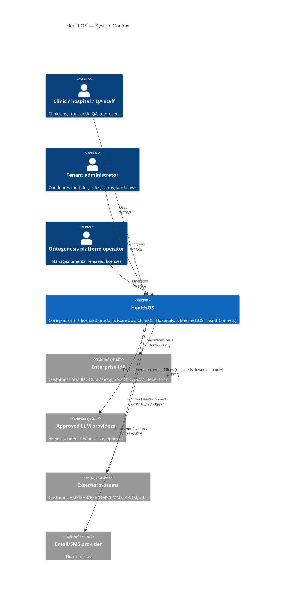
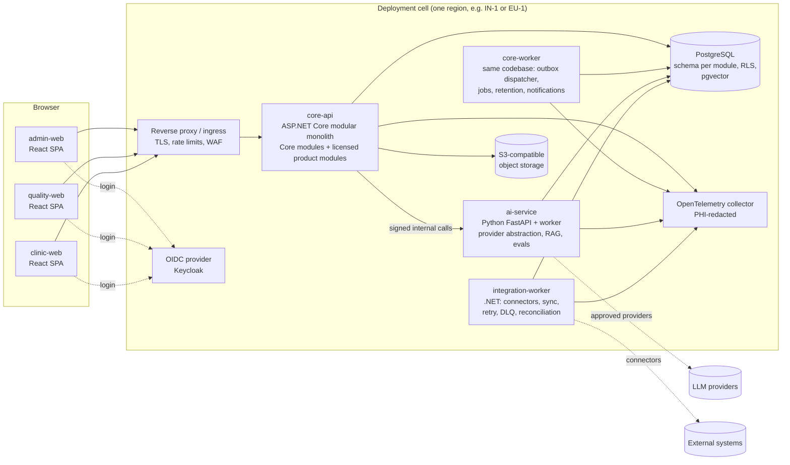

# System Context and Containers (C4 levels 1–2)

## Level 1 — System context

## Level 2 — Containers (single deployment cell)

## Key properties
- **The browser never talks to ai-service or integration-worker directly.** core-api enforces authN/authZ, entitlements and budget, then calls ai-service with a signed, short-lived request context (tenant, user, allowed scopes).
- **core-api and core-worker are the same build**, started in different roles. This keeps the modular monolith deployable as one container image per bundle.
- **One deployment cell per data-residency region.** Tenants are pinned to a cell; no cross-cell PHI replication. (See ADR-0002.)
- **Graceful degradation:** ai-service, integration-worker and LLM providers are optional at runtime; core-api readiness doesn't depend on them.

## Level 3 (component) diagrams
Written per module when the module is built (M2+), in that module's `docs/` folder.
